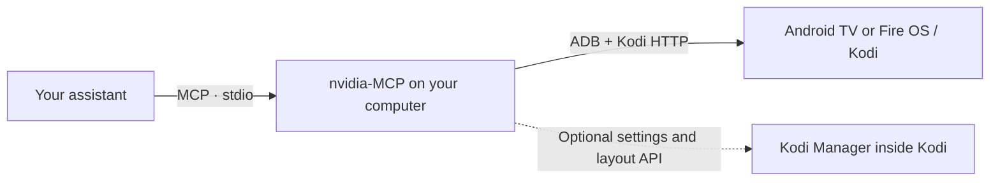
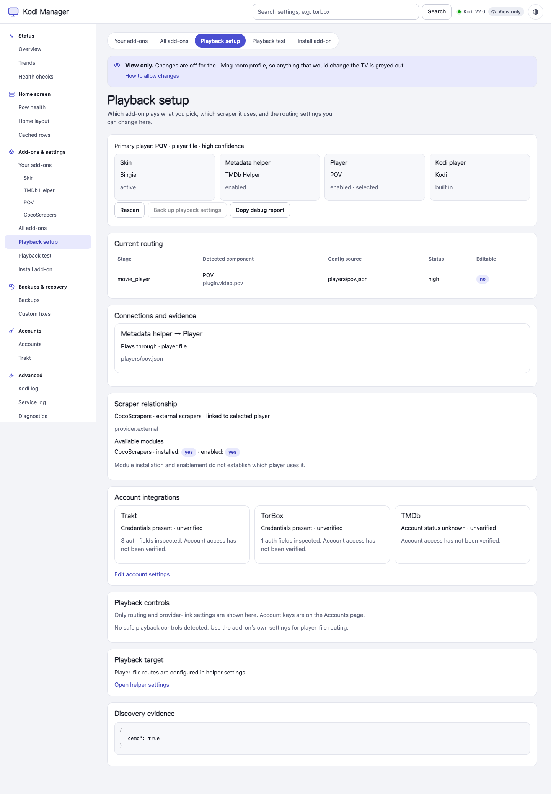

  

  
  
  
  

  <a href="#quick-start">Quick start</a> ·
  <a href="#what-you-can-do">Features</a> ·
  <a href="#optional-kodi-manager-companion">Kodi Manager</a> ·
  <a href="#documentation">Documentation</a>

**Local assistant tools for Kodi and your TV.** nvidia-MCP runs on your computer and lets an MCP
assistant inspect Kodi, diagnose playback problems, preview repairs and apply changes with backups.
It uses public ADB and Kodi HTTP interfaces on NVIDIA Shield, Android TV, Google TV and Android-based
Fire TV. Apple TV support is experimental. No cloud account is required for the server.

> [!NOTE]
> **0.5.10 prerelease.** Read-only by default. Live evidence comes from one customized Shield;
> Fire OS, Google TV and Apple TV hardware validation is pending. See [compatibility](docs/compatibility.md).

## What you can do

- Inspect Kodi's version, profile, skin, add-ons, playback state and redacted logs.
- Diagnose Android apps, connection readiness and native crashes; capture the TV screen.
- Preview configuration repairs, then apply and undo them with checksum checks and private backups.
- Inspect and upgrade local Android APKs with optional SDK tooling and recovery bundles.
- Use optional [Kodi Manager](#optional-kodi-manager-companion) for live settings, playback routing,
  cached rows, configuration checkpoints and reviewed Bingie layouts.

The `nvidia://playbook` resource and `audit_kodi` prompt guide focused audits.
See the [tool reference](docs/tools.md) for each tool's access requirements and limits.

## Quick start

You need a computer, an assistant app that supports **local MCP tools**, and a TV on the same
home network. Your assistant needs permission to run commands and edit files on the computer;
it installs Python 3.11+ and other tools if needed. A browser chat alone cannot do this setup.

1. **Enable debugging.**
   - Use the steps for your [Firestick / Fire TV](docs/android-tv.md#fire-tv--firestick-fire-os),
     [NVIDIA Shield](docs/android-tv.md#nvidia-shield) or
     [Android TV / Google TV](docs/android-tv.md#android-tv--google-tv).
2. **Find the TV's IP address.**
   - Follow step 2 in the same device guide and write down the address shown on your TV.
3. **Enable Kodi remote control.**
   - Follow [setup step 3](docs/setup.md#3-enable-kodi-remote-control).
4. **Let your assistant set up the computer.**
   - Send it the [setup message](docs/setup.md#4-give-this-message-to-your-assistant--on-the-computer).
   - It installs the tools and connects them; you do not need to run commands yourself.
5. **Approve the connection and finish setup.**
   - Select **Allow** on the TV when asked, then wait for the assistant to confirm it works.
   - Want Kodi Manager too? [Ask the agent to install and connect it next](docs/companion.md#ask-your-agent-to-install-kodi-manager).
   - Then ask: **“Read the Kodi repair playbook and audit Kodi without interrupting anything.”**

- **Full instructions**
  - [Start-to-finish setup](docs/setup.md).
  - [Apple TV setup](docs/apple-tv.md), experimental.
  - [Troubleshooting](docs/troubleshooting.md).

Vega OS Firesticks are unsupported; check the [device guide](docs/android-tv.md).

## How it connects

Each server instance targets one explicitly configured device. Apple TV uses an opt-in backend and
separate configuration. Credentials and recovery files stay in your private local storage.

## Optional Kodi Manager companion

[Kodi Manager](https://github.com/glasgowm148/kodi-manager) runs inside Kodi and adds a browser dashboard,
live add-on settings, playback pipeline inspection and supported Bingie layout editing.

Playback setup: routing, scraper connections and integrations

*Current optional companion UI, captured with synthetic demo data in view-only mode. The MCP server itself is a stdio service.*

- **Already using nvidia-MCP?**
  - Ask your agent: **“Install Kodi Manager and connect it to nvidia-MCP.”**
  - Follow [agent-assisted setup](docs/companion.md#ask-your-agent-to-install-kodi-manager).
- **Only want the browser dashboard?**
  - Follow [Kodi Manager's TV remote steps](https://github.com/glasgowm148/kodi-manager/blob/main/docs/setup.md#1-add-the-download-source--inside-kodi).
  - Install from its Kodi repository; no computer file transfer is needed.
- **Need an offline or pinned version?**
  - Use the [bundled ZIP instructions](docs/companion.md#offline-or-pinned-zip-installation).

Repository installations receive preview updates through Kodi's update settings.

## Making changes

**Writes and provider browsing have separate opt-ins.** Inspect and preview before enabling changes.
Disruptive tools check playback and the foreground app; unknown viewing state blocks them. Manager
writes also require its own write mode. Layout editing requires reviewed Bingie / Skin Shortcuts
versions **and source hashes**; unknown variants stay view-only.

Use a trusted LAN and keep credentials, logs and backups private. Repair tools have platform-specific
limits; the optional Android profile-relaunch helper needs separate private deployment.
See [operation rules](docs/configuration.md), [repair workflows](docs/repairs.md),
[APK recovery](docs/apk-upgrades.md) and [Apple TV limits](docs/apple-tv.md).

## Tool reference

The complete [generated tool catalogue](docs/tools.md) lists Android/Shield tools and access gates.
Apple TV has a separate [capability table](docs/apple-tv.md#what-matches-the-shield-workflow).

## Documentation

Start with the [documentation index](docs/README.md), or go directly to:

| I want to… | Guide |
| --- | --- |
| Set up a TV and assistant | [TV preparation](docs/setup.md) · [Agent setup](docs/agent-setup.md) |
| Connect Android / Fire TV or Apple TV | [Android / Fire OS](docs/android-tv.md) · [Apple TV](docs/apple-tv.md) |
| Use the dashboard and live settings | [Kodi Manager companion](docs/companion.md) |
| Configure access or repair a problem | [Configuration](docs/configuration.md) · [Repairs](docs/repairs.md) |
| Check support or reuse the Python code | [Compatibility](docs/compatibility.md) · [Library](docs/library.md) |

[Contributing](CONTRIBUTING.md) · [Changelog](CHANGELOG.md) · [Security](SECURITY.md) · [MIT license](LICENSE).
Independent project; not affiliated with NVIDIA, the Kodi Foundation or any add-on author.
